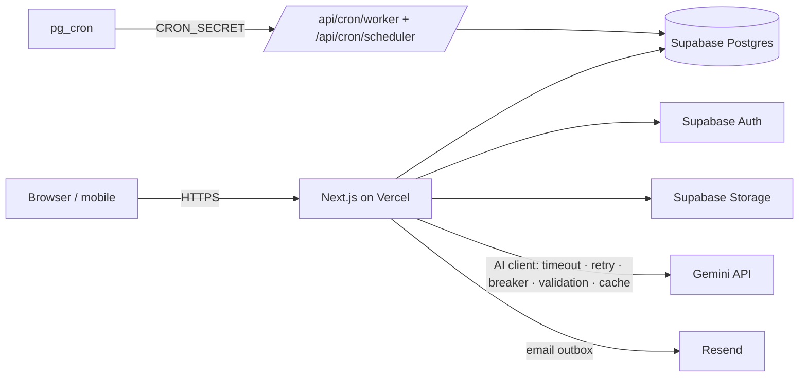
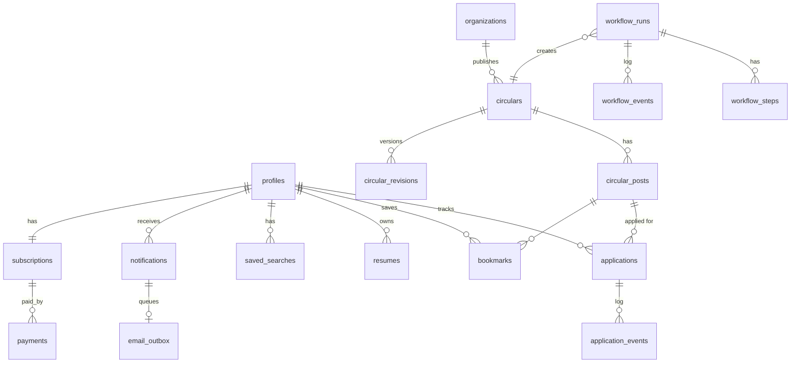

# চাকরি রাডার — Chakri Radar

[](https://github.com/Arina-Arni/chakri-ghor/actions/workflows/ci.yml)

**Hack the Vibe 2026 · World Problem Solver track** · Advanced challenges: **A06 External API & Fault Tolerance**, **A07 Automated Multi-Step Workflow**

## Problem and users

Bangladesh's job circulars, especially government ones, are scattered across hundreds of websites. Seekers find out late, can't easily tell if they are eligible (age counted on a specific date, district and education rules per post), and many lack an ATS-friendly English CV.

Chakri Radar is a Bangla-first web app for:

- **Job seekers:** mobile-first, many outside Dhaka.
- **Moderators and admins:** they ingest, verify and publish circulars.

## Features

- **Discovery:** full-text search (trigram + ILIKE, Bangla and English), facets, sort, keyset paging, zero-result suggestions, and **AI search** that turns a sentence into filters.
- **Eligibility engine:** exact age on the reference date (Feb-29 and quota relaxations included), education, subject, district, gender, experience and the application window.
- **Profile and resumes:** onboarding wizard with **AI CV parsing**, an English ATS resume with a deterministic score, **AI tailoring** behind a hallucination guard, and PDF download.
- **Tracker and reminders:** application state machine, deadline reminders (72 h / 24 h / 3 h) and exam reminders, in-app notifications plus email (Resend outbox).
- **Admin:** circular CRUD with review, the **ingestion workflow** (PDF, URL or text → AI extraction → review → publish → notify), AI health, fault injection, users and roles, audit log, feature flags and plans.
- **Plans:** Free and Premium quotas, a 7-day trial, mock payments with signed, idempotent webhooks.
- **Real data:** government circulars from Teletalk, and private and NGO jobs taken only from the employers' own career pages (BRAC, BRACNet, BRAC International). The live site has no sample data. Admins can also check Teletalk's private-jobs list from `/admin/ingest`.
- **Interface:** Bangla-first, light and dark themes (WCAG AA contrast), a role badge in the account menu, and a muted login animation that respects reduced motion.

Screens: [docs/UI.md](docs/UI.md) (mobile and desktop screenshots).

## Where to find A06 and A07

- **A06:** one AI client, [`src/lib/ai/client.ts`](src/lib/ai/client.ts). It handles timeouts, retries with jitter and Retry-After, a circuit breaker, JSON repair, semantic checks, cache, quotas and scoped fault injection. Calls are logged and shown on `/admin/ai-health`.
- **A07:** our own workflow engine, [`src/lib/workflow/engine.ts`](src/lib/workflow/engine.ts), with the ingestion steps in [`src/server/workflow/ingest.ts`](src/server/workflow/ingest.ts). It has leases, persisted outputs, resume, branching, a review gate and compensation. The timeline is on `/admin/workflows/[id]`.
- **Details and step-by-step reproduction:** [docs/CHALLENGES.md](docs/CHALLENGES.md). Rubric mapping: [docs/RUBRIC_MAP.md](docs/RUBRIC_MAP.md).

## Architecture



How a request flows:

1. A screen calls `src/data/*`.
2. Reads go to `POST /api/q/<name>`; writes are Server Actions; files go to Route Handlers.
3. Each one calls `src/server/services/*`. Every service runs `authorize()`, then pure `src/domain/*` logic, then Drizzle.

## Data model (main tables)



There are also `ai_calls`, `ai_cache`, `circuit_breakers`, `fault_injections`, `usage_counters`, `plans`, `feature_flags`, `idempotency_keys`, `audit_logs` (append-only), `search_logs` and `rate_limits`. RLS is enabled on every table.

## Tech stack

Next.js 16 (App Router, TypeScript strict) · Tailwind CSS 4 + shadcn/ui · Supabase (Postgres, Auth, Storage, pg_cron) · Drizzle ORM · Google Gemini (`@google/genai`) · Resend + React Email · Vitest · PGlite · Playwright · Vercel.

## Local setup

1. Create a Supabase project.
   - Enable the Email (with confirmation) and Google providers.
   - Add `<APP_URL>/auth/callback` and `<APP_URL>/auth/confirm` as redirect URLs.
   - Enable the `pg_cron` and `pg_net` extensions.
2. Copy `.env.example` to `.env.local` and fill it in. Never commit it.
3. Run:

```bash
npm install
npm run db:migrate   # drizzle/*.sql over DIRECT_URL
npm run db:seed      # optional, development database only (see below)
npm run dev
```

`db:seed` adds sample circulars, demo workflow runs and one demo user per role, and writes the demo logins to the git-ignored `.seed-credentials.local.md`. Run it only on a database you use for development. **Never run it against the production database:** the live site shows real circulars only. To try the app without Supabase, `npm run db:local` starts a throwaway seeded Postgres instead.

**Test accounts are provided privately to the judges.**

### Environment variables

| Name | Purpose |
|---|---|
| `NEXT_PUBLIC_SUPABASE_URL`, `NEXT_PUBLIC_SUPABASE_ANON_KEY` | Supabase project URL and anon key |
| `SUPABASE_SERVICE_ROLE_KEY` | server only: storage, account deletion, seeding |
| `DATABASE_URL` / `DIRECT_URL` | pooler (app) / direct connection (migrations) |
| `APP_URL` | public URL (email links, cron, sitemap) |
| `IP_HASH_SALT` | salt for IP hashes; raw IPs are never stored |
| `GEMINI_API_KEY`, `GEMINI_MODEL` | AI. Without a key every feature uses its fallback |
| `GEMINI_FALLBACK_MODELS` | optional, comma-separated; tried when `GEMINI_MODEL` is out of quota (default `gemini-3.5-flash-lite`) |
| `RESEND_API_KEY`, `EMAIL_FROM` | email. Without a key, emails stay queued |
| `CRON_SECRET` | auth for `/api/cron/*` (constant-time compare) |
| `FAULT_INJECTION_ALLOWED` | `true` lets admins inject AI faults into their own requests. Set it on the judged deployment for the A06 demo |
| `PAYMENT_PROVIDER`, `PAYMENT_WEBHOOK_SECRET` | `mock`; HMAC secret for webhooks |
| `INGEST_ALLOWED_HOSTS` | optional extra hosts for PDF-URL ingest |
| `NEXT_PUBLIC_SAMPLE_DATA_NOTICE` | `1` shows the "sample data" footer notice. Leave it unset in production |

## Scripts

```bash
npm run typecheck && npm run lint
npm test                  # unit: domain, A06 client, guards, state machines
npm run test:integration  # real Postgres (PGlite locally, Postgres service in CI): authz, IDOR, A07, scheduler, payments
npm run check:fixtures    # nothing imports the removed Part 1 fixtures
npm run build && npm run check:secrets
npm run db:generate | db:migrate | db:seed | db:cron | db:local
npm run samples           # demo PDFs in /samples
npm run e2e               # Playwright; needs E2E_BASE_URL + E2E_* credentials of a seeded deployment
```

## Deployment

1. Link the GitHub repo to a Vercel project; `main` auto-deploys to production.
2. In Vercel, add the env vars from `.env.local`, with two changes:
   - `APP_URL` is the production URL, not `localhost`.
   - Add `FAULT_INJECTION_ALLOWED=true` for the A06 demo.

   `DIRECT_URL` is only for migrations, so it is not needed in Vercel.
3. In Supabase, open **Authentication → URL Configuration**. Set **Site URL** to the production URL and add `<production URL>/**` to **Redirect URLs**. Otherwise confirmation and Google sign-in links point to `localhost`.
4. Against the production database, run `npm run db:migrate`. Do **not** run `db:seed` there; it adds sample data and demo accounts.
5. Run `npm run db:cron` once with the production URL. It schedules `worker` (every minute) and `scheduler` (every 15 minutes) in pg_cron. Without it, the following don't run on their own:
   - deadline and exam reminders
   - auto-closing of expired circulars
   - delayed workflow retries
   - the email outbox

   A new ingest still runs at once. On a run's page, **Retry**, **Resume from step**, **Skip** and **Edit & continue** also run it at once. A variable already set in the shell wins over `.env.local`:

   ```bash
   APP_URL=https://<your-app>.vercel.app npm run db:cron            # bash
   $env:APP_URL="https://<your-app>.vercel.app"; npm run db:cron     # PowerShell
   ```
6. Check `/api/health` for the DB, breakers, outbox backlog and workflow backlog.

## Testing

| Layer | What it covers |
|---|---|
| Unit (Vitest) | eligibility boundaries, every state-machine pair, the search parser, matching, the A06 client (fake timers + scripted provider), the hallucination guard, ingest normalization, the subscription machine |
| Integration (real Postgres) | authorization and IDOR, role escalation, duplicates, idempotency replay, conflicts, rollback, exact dashboard numbers, the full A07 scenarios, scheduler idempotency, outbox retries, duplicate webhooks |
| E2E (Playwright) | routes plus axe on mobile and desktop, keyboard, Part 3 journeys (skipped without a seeded deployment) |
| CI | npm audit, typecheck, lint, unit, integration (Postgres service), build, a secret check on the client bundle, and E2E against a preview when configured |

## Limitations and future work

- No automatic scraping of government sites: circulars are uploaded, linked or pasted.
- Private jobs come from a few employers' official career pages. Paid job boards such as Bdjobs are not copied, because their listings are employers' paid ads. Teletalk's private-jobs list was empty when checked (26 Nov 2026); admins can re-check it from `/admin/ingest`.
- Users apply on the official site. The app links there and tracks the application, but it does not submit applications itself.
- Gemini's free tier allows about 20 requests per model per day. When the quota runs out, every AI feature uses its fallback, such as the rule-based search parser.
- Without an email provider (`RESEND_API_KEY`), notifications are in-app only. Supabase's built-in auth emails are rate-limited.
- Payments use a mock provider behind the `PaymentProvider` interface; bKash, SSLCommerz and carrier billing come at launch.
- Scanned PDFs need Gemini vision; there is no local OCR.
- Next: employer portal, PWA with push notifications, Sentry, an English toggle, staging and backups.

Docs: [PLAN](docs/PLAN.md) · [DECISIONS](docs/DECISIONS.md) · [UI](docs/UI.md) · [CHALLENGES](docs/CHALLENGES.md) · [RUBRIC_MAP](docs/RUBRIC_MAP.md) · [TEST_SCENARIOS](docs/TEST_SCENARIOS.md) · [DEMO_SCRIPT](docs/DEMO_SCRIPT.md) · [SUBMISSION](docs/SUBMISSION.md)